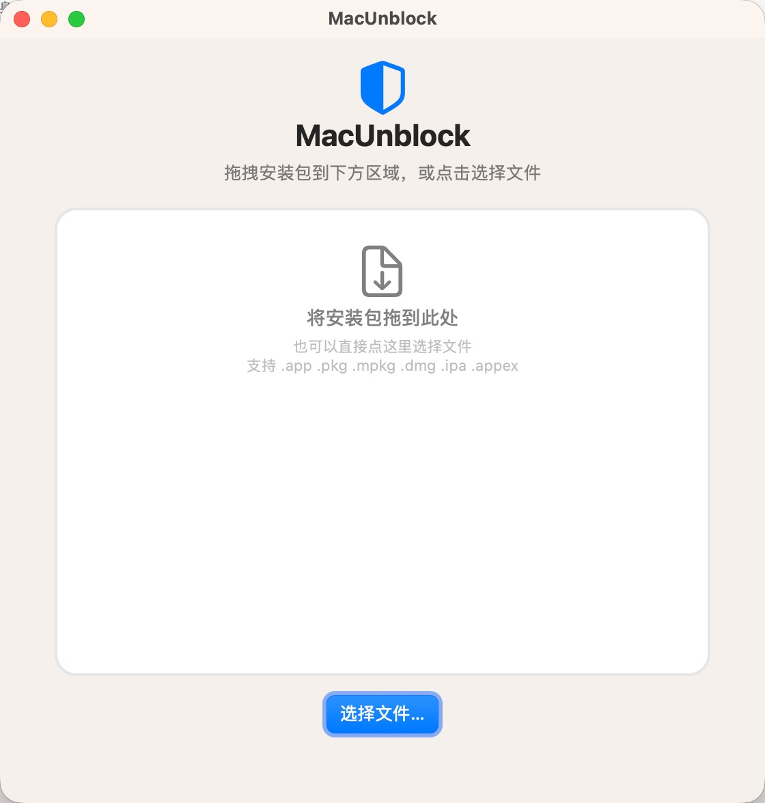
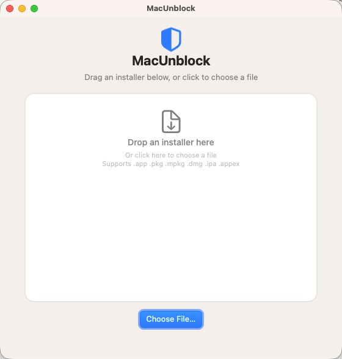

[](https://github.com/iamxz/MacAppFixer/actions/workflows/ci.yml)
[](https://github.com/iamxz/MacAppFixer/releases)
[](https://opensource.org/licenses/MIT)

# MacAppFixer

[English](README.md) | **简体中文**


**修复 Mac 应用装不上 / 打不开：「已损坏，无法打开」「来自身份不明的开发者」。**

一个 macOS 小工具：拖入或选中安装包，一键移除隔离属性（`com.apple.quarantine` 等），让提示消失。

支持 `.app`、`.pkg`、`.mpkg`、`.dmg`、`.ipa`、`.appex`。界面中英双语，跟随系统「语言与地区」自动切换。

## 截图

<p align="center">
  
  &nbsp;&nbsp;
  
</p>

## 功能

- **拖拽** 或 **选择文件**（支持多选、批量）
- **递归清理** bundle 内的 `com.apple.quarantine` / `com.apple.provenance`
- **保留** `com.apple.FinderInfo` / `com.apple.ResourceFork`（图标、标签不受影响）
- **中英双语**，随系统语言自动切换
- **纯本地、无网络**

## 系统要求

- macOS 12.0+ (Monterey)
- 构建需要 Xcode 命令行工具（`swift` / `xcrun`）

## 安装

### 方式一：下载安装包（推荐）

从 [GitHub Releases](https://github.com/iamxz/MacAppFixer/releases) 下载最新的 `.pkg`，双击安装到 `/Applications/MacAppFixer.app`；或下载 `.app.zip` 解压后拖入「应用程序」。

> app 为 ad-hoc 签名、未公证，首次可能被 Gatekeeper 拦截：右键「打开」，或 系统设置 → 隐私与安全性 → 仍要打开。

> 本项目曾用名 **MacUnblock**（旧 bundle id `com.macunblock.app`）。bundle id 已变，新版本不会覆盖旧安装，请先手动删除 `/Applications/MacUnblock.app`。

### 方式二：从源码构建

```bash
git clone https://github.com/iamxz/MacAppFixer.git
cd MacAppFixer
make install      # 编译 → 签名 → 安装到 /Applications/MacAppFixer.app
```

## 使用方法

1. 打开 `/Applications/MacAppFixer.app`
2. 把文件**拖到窗口拖拽区域**；或**点击区域 / 「选择文件…」**（⌘ / ⇧ 可多选）
3. 自动移除隔离属性，结果在底部显示

## 常见问题

**提示权限不足？** 桌面 / 下载 / 文稿等目录首次访问会请求「完全磁盘访问权限」，点击「允许」；若之前拒绝过，在 系统设置 → 隐私与安全性 → 完全磁盘访问权限 中勾选 MacAppFixer 后重启。

**重新构建后又要重新授权？** 应用使用 ad-hoc 签名，每次重编译身份都变。固定在 `/Applications` 并减少重编译即可减少打扰。

**界面语言不对？** 应用跟随系统语言。到 系统设置 → 通用 → 语言与地区 调整首选语言后重启。

## 替代方案（终端手动执行）

```bash
xattr -r -d com.apple.quarantine /path/to/YourApp.app
xattr -d  com.apple.quarantine /path/to/Installer.pkg
xattr -d  com.apple.quarantine /path/to/DiskImage.dmg
```

本应用只是把这些操作封装成了图形界面。

## 开发

使用 Swift Package Manager 构建，常用 `make` 目标：

| 命令 | 作用 |
|------|------|
| `make` / `make build` | 编译 + 组装 → `build/MacAppFixer.app` |
| `make universal` | 通用架构（arm64 + x86_64） |
| `make test` | 单元测试 |
| `make install` | 组装 + 安装到 `/Applications` |
| `make dist` | `pkg` + `.app.zip` + `checksums.txt`（发版） |

界面文案放在 `Resources/{en,zh-Hans}.lproj/Localizable.strings`，通过 `L.t("key")` 读取——改文案时两个文件都要改。应用**刻意不启用 App Sandbox**（沙箱进程禁止写入隔离 xattr），并在进程内直接调用 `listxattr` / `removexattr`，而非调用 `/usr/bin/xattr` 子进程。

发版：先写好 `docs/release-notes/vX.Y.Z.md`，再执行 `make release VERSION=<x.y.z|patch|minor|major> MSG="…"`，推送 tag 后 GitHub Actions 自动发布 Release。详见 [AGENTS.md](AGENTS.md)。

## 赞助支持

如果这个小工具帮到了你，欢迎请作者喝杯咖啡 ☕

用 **微信** 或 **支付宝** 扫码即可支持，你的鼓励是继续维护下去的动力：

<table align="center" cellpadding="14">
  <tr>
    <td align="center"></td>
    <td align="center"></td>
  </tr>
  <tr>
    <td align="center">微信支付</td>
    <td align="center">支付宝</td>
  </tr>
</table>

> 应用内的「赞助 ♥」按钮不做弹窗，直接用默认浏览器打开本仓库页面。

## License

[MIT](LICENSE) © 2026 iamxz
